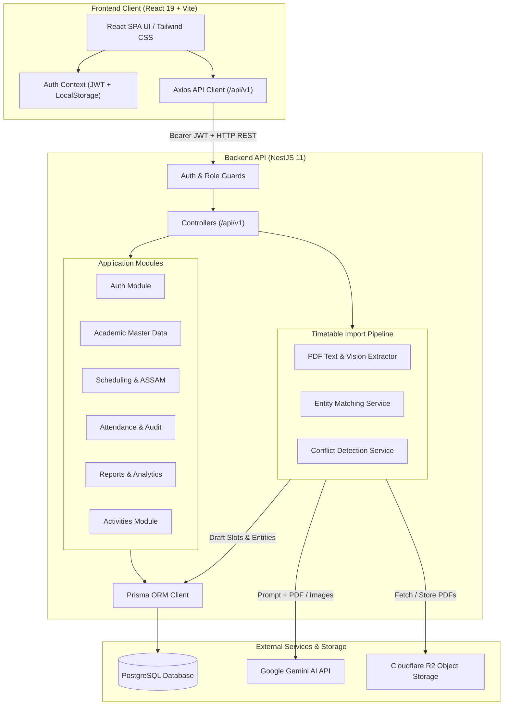
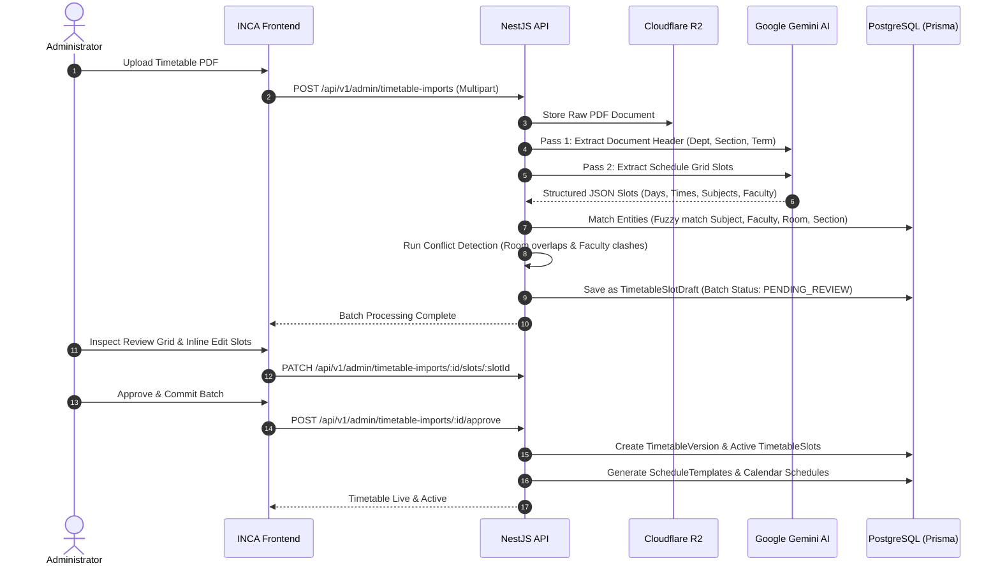

# INCA — Intelligent Campus Assistant

A unified campus operating platform combining AI-driven timetable scheduling, multi-role attendance tracking, and institutional analytics.


> 🔗 **Live App:** Landing page at https://incaweb.netlify.app/. The full app needs the backend and database, so see [Getting Started](#getting-started) to run it locally, or watch the [demo video](DEMO_VIDEO_LINK_HERE).

> 📹 [Watch the demo video](DEMO_VIDEO_LINK_HERE)

---

## Overview

Colleges and universities routinely rely on fragmented tools—paper registers, static PDF schedules, disconnected notice boards, and disparate messaging groups—creating administrative bottlenecks and poor visibility into student engagement. INCA (Intelligent Campus Assistant) solves this fragmentation by consolidating campus operations into a centralized, role-based platform. At its core is ASSAM (Academic Scheduling & Smart Attendance Management), an operational engine that parses complex timetable PDFs using Gemini AI, detects schedule conflicts, automates lecture-level attendance workflows, and provides real-time academic analytics for administrators, faculty, coordinators, and students.

---

## Features

### Implemented & Verified in Code

- **ASSAM Engine (Academic Scheduling & Smart Attendance Management):** Complete scheduling backbone connecting academic terms, degree programs, lecture templates, classroom allocations, and calendar schedule instances.
- **Two-Pass AI Timetable PDF Import:** Automated extraction pipeline in `backend/src/modules/scheduling/timetable-import/` utilizing Google Gemini models (`@google/genai`). Extracts metadata headers (institute, department, semester, section, room, effective date) and full tabular grid slots (lecture slots, merged multi-period labs, subject codes, faculty codes). Also supports direct single-pass PDF parsing.
- **Entity Matching & Conflict Detection Engine:** Heuristic matching service that cross-references extracted raw text with database entities (subjects, faculty, rooms, sections) providing confidence scores, coupled with conflict analysis that identifies classroom double-booking and instructor overlaps.
- **Interactive Draft Review Grid:** Administrative interface to inspect extracted batches, view conflict warnings, edit cells inline, adjust slot assignments, and commit verified drafts into active timetable versions.
- **Role-Based Portals & Dashboards:** Tailored dashboard views based on authenticated JWT roles:
  - **Super Admin:** Institution-wide health metrics, administrative user accounts, system configuration (attendance thresholds, edit windows), and system audit logs.
  - **Admin & HOD:** Departmental overviews, timetable import batches, faculty workload metrics, and at-risk student lists (<75% attendance).
  - **Academic Coordinator:** Section schedule supervision, timetable reviews, and attendance verification.
  - **Faculty:** Daily lecture schedules, one-click attendance launching, roster summaries, and pending session submissions.
  - **Student:** Real-time attendance percentage breakdown per subject, visual progress gauges, shortage alerts, and schedule views.
- **Flexible Attendance Marking:** Fast attendance recording supporting both a Tinder-style **Card Swipe** interface (swipe right for Present, swipe left for Absent) and a traditional **List View**, with status tracking for `PRESENT`, `ABSENT`, `LATE`, and `EXCUSED`.
- **Attendance Audit Trail:** Tamper-evident audit logging for any post-submission attendance modifications, recording previous status, new status, modifying user ID, timestamp, and mandatory justification remarks.
- **Academic Master Data Management:** Comprehensive administrative CRUD interfaces for managing Departments, Programs, Semesters, Sections, Subjects (with lab flags), Classrooms (with capacity and building), Faculty profiles, and Student enrollment records.
- **Institutional Reporting & Analytics:** Dedicated reporting dashboard with multi-dimensional filtering across Student, Section, Subject, and Faculty dimensions, complete with low-attendance warnings and date range parameters.
- **Co-Curricular Activities Module:** Scheduling and attendance logging for guest lectures, workshops, seminars, and placement drives.

### Planned (Coming Soon in UI Hub)

The following modules appear as preview cards on the post-login Feature Hub and are planned for future phases:

- **AI Notes & Tutor:** Lecture transcript processing, automated summary generation, and interactive chat-based tutoring.
- **Campus Marketplace:** Peer-to-peer textbook and student item exchange.
- **Digital Notice Board:** Departmental announcements and centralized circular feeds (backend stub currently returns placeholder).
- **Community Polls:** Institutional voting and student feedback surveys.
- **Green Credits System:** Campus ecological tracking and student transit credits.
- **AR Campus Navigation:** Augmented reality indoor classroom wayfinding.

---

## Screenshots

### Landing Page


### Post-Login Feature Hub


### Role-Based Dashboard


### Timetable PDF Import & AI Review


### Smart Attendance Marking


### Master Data Management


### Attendance Reports & Analytics


---

## Architecture

INCA uses a decoupled client-server architecture. The frontend is a React 19 single-page application communicating via REST APIs with a modular NestJS backend. Persistence is managed via Prisma ORM connected to PostgreSQL, document binaries are stored in Cloudflare R2, and timetable document understanding is executed through Google Gemini.



*Architecture summary: React 19 SPA -> NestJS REST API (JWT/Role Guards) -> Prisma ORM -> PostgreSQL, backed by Cloudflare R2 for document storage and Google Gemini for AI timetable parsing.*

### Timetable Import & Verification Pipeline



---

## Tech Stack

| Layer | Technology | Purpose |
| :--- | :--- | :--- |
| **Frontend Framework** | React 19.2.8 | Single-page application rendering and user interface |
| **Frontend Build Tool** | Vite 8.2.0 | Development server, bundling, and hot module replacement |
| **Styling** | Tailwind CSS 4.3.3 | Utility-first responsive design and layout system |
| **UI Components** | Radix UI Primitives | Accessible, unstyled primitives (Dialog, Dropdown, Select, Avatar, Tooltip) |
| **Icons & Animation** | Lucide React 1.33.0 & Framer Motion 13.1.1 | Vector iconography and UI micro-interactions |
| **Data Fetching** | TanStack React Query 5.101.4 | Server state management, query caching, and synchronization |
| **Tables & Charts** | TanStack React Table 8.21.3 & Recharts 3.10.1 | Data tables for master data and visual analytics |
| **Form Handling** | React Hook Form 7.85.0 & Zod 4.4.3 | Schema validation and input handling |
| **Backend Framework** | NestJS 11.0.1 | Modular enterprise TypeScript server architecture |
| **Language & Runtime**| Node.js / TypeScript 5.7.3 | Typed execution across backend and frontend codebases |
| **Database & ORM** | PostgreSQL & Prisma ORM 6.19.3 | Relational schema definitions, migrations, and database client |
| **Authentication** | Passport.js & JWT (`@nestjs/jwt`) | Role-based token authentication and route authorization |
| **AI Document Extraction** | Google Gemini (`@google/genai` 2.20.0) | Multimodal PDF OCR and structured timetable grid extraction |
| **Cloud Object Storage**| AWS S3 Client (`@aws-sdk/client-s3` 3.1116.0) | Cloudflare R2 integration for storing raw timetable PDFs |
| **PDF Processing** | `pdf-parse` & `pdf-to-png-converter` | Local PDF buffer processing and fallback page rendering |
| **API Documentation** | Swagger (`@nestjs/swagger` 11.4.6) | Interactive OpenAPI documentation endpoint (`/docs`) |

---

## Project Structure

```text
INCA/
├── backend/                # NestJS 11 API server, Prisma ORM, and AI timetable import pipeline
│   ├── prisma/             # Database schema (schema.prisma), migrations, and role seed script
│   ├── src/                # NestJS modules (auth, academic, scheduling, attendance, reports)
│   ├── test/               # Jest unit and end-to-end test configurations
│   ├── package.json        # Backend package configuration and scripts
│   └── tsconfig.json       # Backend TypeScript compiler settings
├── frontend/               # React 19 client application built with Vite and Tailwind CSS v4
│   ├── public/             # Static assets (favicons, manifest)
│   ├── src/                # React pages, layout wrappers, components, hooks, and API client
│   ├── package.json        # Frontend package configuration and scripts
│   └── vite.config.ts      # Vite bundler plugins and path aliases
├── docs/                   # Documentation assets and screenshots
│   └── screenshots/        # Application interface screenshots
├── DESIGN.md               # Visual design specifications and tokens
├── LICENSE                 # MIT License (Akshhat Srivastava)
└── README.md               # Main project documentation
```

---

## Getting Started

### Prerequisites

- **Node.js:** Not specified in `package.json` engines (Node.js LTS `v20.x` or `v22.x` recommended).
- **Package Manager:** `npm` (bundled with Node.js).
- **Database:** PostgreSQL database instance (local or hosted like Neon / Supabase).
- **Google Gemini API Key:** Required for timetable PDF AI parsing.
- **Cloudflare R2 Bucket (Optional):** Required if storing uploaded PDFs in cloud storage.

---

### Environment Variables

#### Backend (`backend/.env`)

Configure these variables in `backend/.env` (reference: `backend/.env.example`):

| Variable | Description | Required |
| :--- | :--- | :---: |
| `DATABASE_URL` | PostgreSQL connection string with schema parameters | **Y** |
| `JWT_SECRET` | Secret key used for signing access JWT tokens | **Y** |
| `JWT_REFRESH_SECRET` | Secret key used for signing refresh JWT tokens | **Y** |
| `FRONTEND_URL` | Allowed client origin for CORS (e.g. `http://localhost:5173`) | **Y** |
| `PORT` | HTTP port for the NestJS server (defaults to `3000`) | N |
| `GEMINI_API_KEY` | Google Gemini API key for timetable vision extraction | **Y** (for imports) |
| `GEMINI_MODEL` | Gemini model name (defaults to `gemini-3.6-flash`) | N |
| `R2_ACCOUNT_ID` | Cloudflare account identifier for R2 storage | N |
| `R2_BUCKET_NAME` | Cloudflare R2 bucket name | N |
| `R2_ACCESS_KEY` | Cloudflare R2 S3-compatible access key ID | N |
| `R2_SECRET_KEY` | Cloudflare R2 S3-compatible secret access key | N |
| `DB_MAX_RETRIES` | Connection retry count on server startup (defaults to `5`) | N |

#### Frontend (`frontend/.env`)

Configure these variables in `frontend/.env`:

| Variable | Description | Required |
| :--- | :--- | :---: |
| `VITE_API_URL` | Base URL for backend REST API (defaults to `http://localhost:3000/api/v1`) | N |

---

### Installation

Follow these steps to configure the backend and frontend:

#### 1. Backend Setup

```bash
# Navigate to the backend directory
cd backend

# Install dependencies
npm install

# Copy environment template and fill in your DATABASE_URL and secrets
cp .env.example .env

# Generate the Prisma client
npx prisma generate

# Run database migrations
npx prisma migrate dev

# Seed database with initial roles and the default Super Admin user
npx prisma db seed
```

#### 2. Frontend Setup

```bash
# Navigate to the frontend directory
cd ../frontend

# Install dependencies
npm install

# Create environment configuration (optional if using default port 3000)
# echo VITE_API_URL=http://localhost:3000/api/v1 > .env
```

---

### Running Locally

Run both servers concurrently in separate terminal windows:

#### Start Backend

```bash
cd backend
npm run start:dev
```
- Server starts at: `http://localhost:3000`
- Swagger API Documentation: `http://localhost:3000/docs`
- Health check endpoint: `http://localhost:3000/health`

#### Start Frontend

```bash
cd frontend
npm run dev
```
- Web application starts at: `http://localhost:5173`

---

## Usage

### Default Credentials (from Seed)

The seed script (`backend/prisma/seed.ts`) populates initial roles (`SUPER_ADMIN`, `ADMIN`, `HOD`, `FACULTY`, `COORDINATOR`, `STUDENT`) and creates a default administrator:

- **Email:** `admin@bit.ac.in`
- **Password:** `Admin@123`
- **Assigned Role:** `SUPER_ADMIN`

*(Note: Additional role profiles can be created directly from the Master Data / Super Admin panels.)*

---

### Key Workflows by Role

#### 1. Timetable PDF Import (Admin / HOD)
1. Log in with an `ADMIN` or `HOD` account and navigate to **Academic -> Timetable Imports** (`/academic/timetable-imports`).
2. Upload a university timetable PDF document.
3. The system dispatches the file to Gemini AI, executing header extraction and grid parsing.
4. Open the **Review Grid** to inspect extracted lecture slots, review confidence scores, and resolve any highlighted room or instructor conflicts.
5. Make inline edits to any subject, faculty, or room mappings if necessary.
6. Click **Approve & Commit** to publish the active `TimetableVersion` and generate corresponding `ScheduleTemplate` records.

#### 2. Taking Attendance (Faculty / Coordinator)
1. Log in with a `FACULTY`, `HOD`, or `COORDINATOR` account.
2. The Faculty Dashboard presents the list of lectures scheduled for today.
3. Click **Mark Attendance** (`/attendance/mark?scheduleId=...`) for the current lecture.
4. Choose between:
   - **Card Swipe Mode:** Rapidly review student profile cards (Swipe right for Present, swipe left for Absent).
   - **List Mode:** View the full alphabetical student roster with toggles for Present, Absent, Late, or Excused.
5. Click **Submit Attendance Session** to finalize records.
6. If an adjustment is needed later, open the **Audit Modal**, select the student record, enter the revised status along with a mandatory audit reason, and submit.

#### 3. Monitoring Academic Engagement (Student)
1. Log in with a `STUDENT` account.
2. The Student Dashboard displays:
   - Total attended lectures vs. total delivered sessions.
   - Aggregate attendance percentage with color-coded threshold alerts (warning if below the mandatory 75% requirement).
   - Subject-by-subject attendance progress bars.
   - Upcoming lecture timetable for the day.

#### 4. Managing Campus Master Data (Super Admin / Admin)
1. Navigate to **Academic Management** (`/academic`).
2. Manage institutional hierarchies: Departments, Degree Programs, Semesters, and Sections.
3. Maintain classroom lists with capacities and building numbers.
4. Manage Faculty designations and assign students to specific sections.

---

## Known Limitations

- **Public Deployment Status:** The live URL (`https://incaweb.netlify.app/`) hosts the frontend landing page. The full application requires a running NestJS backend and PostgreSQL database; it must be run locally or deployed to a server environment.
- **Secondary Hub Features:** Features in the Feature Hub other than ASSAM (such as AI Notes & Tutor, Campus Marketplace, Digital Notice Board, Community Polls, and Green Credits) are UI placeholders labeled "Coming Soon" and are not yet connected to backend services.
- **Timetable Layout Variance:** While the Gemini vision extraction pipeline handles complex multi-section grids, non-standard or heavily distorted timetable PDFs may require manual adjustments in the interactive review grid before publishing.
- **Cloud Storage Configuration:** PDF file persistence requires valid Cloudflare R2 / S3 credentials; if unset, PDF upload relies on local processing buffers.

---

## Footer

- **License:** [MIT License](LICENSE) © 2026 Akshhat Srivastava
- **Author:** Akshhat Srivastava
- **Repository:** [https://github.com/exceptional007/INCA.git](https://github.com/exceptional007/INCA.git)
- 🔗 **Live App:** Landing page at https://incaweb.netlify.app/. The full app needs the backend and database, so see [Getting Started](#getting-started) to run it locally, or watch the [demo video](DEMO_VIDEO_LINK_HERE).