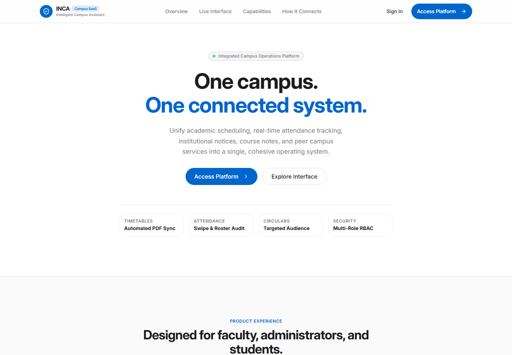
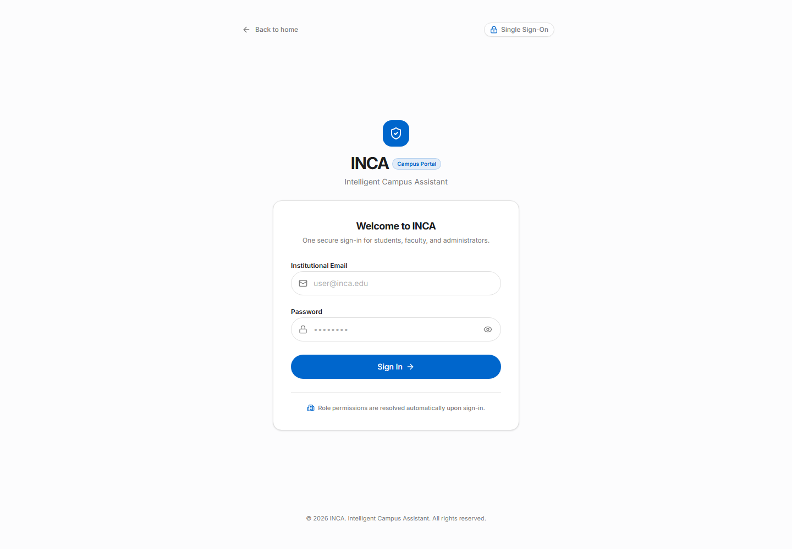
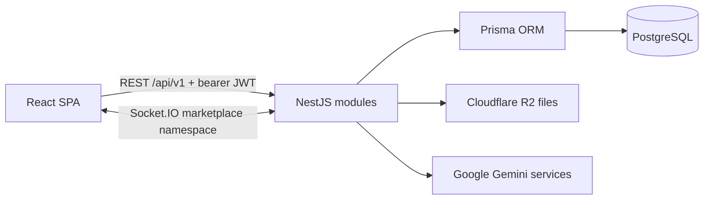

# INCA — Intelligent Campus Assistant

INCA brings campus scheduling, attendance, academic records, learning resources, and community services into one role-based application. ASSAM is its academic scheduling and attendance module.

[Local demo walkthrough](docs/demo.md) · [Frontend guide](frontend/README.md) · [Backend guide](backend/README.md) · [Screenshot gallery](docs/screenshots/README.md)

[Render backend + Netlify frontend deployment](docs/deploy-render-netlify.md)

Account security now includes rotating refresh sessions, mandatory initial-password changes, recovery, and revocation. Every role has an approval-based [profile and security page](docs/account-profile.md), with [desktop](docs/screenshots/profile-demo.png) and [mobile](docs/screenshots/profile-mobile-demo.png) captures using synthetic data.

## Demo availability

The supported demonstration is the [local walkthrough](docs/demo.md). Public pages can be viewed with only the frontend running; authenticated workflows require a configured backend, PostgreSQL database, and appropriate accounts.

No published demo-video URL or verified full-application deployment is available in this repository. The previously documented [Netlify landing-page URL](https://incaweb.netlify.app/) could not be verified during this documentation update; it is not a verified full-app demo.

## Application modules

| Module | Current implementation |
| --- | --- |
| Academic data | Departments, programs, semesters, sections, subjects, rooms, faculty, and student enrollment |
| Scheduling / ASSAM | Templates, dated schedules, exceptions, PDF timetable extraction, draft review, conflict detection, and active timetable versions |
| Attendance | Lecture and activity sessions, card/list marking, submission, corrections, and audit records |
| Reports | Attendance summaries and filters for students, subjects, sections, and faculty |
| Activities | Faculty-organised events and associated attendance |
| Notes, tutor, and quizzes | PDF/DOCX or Drive-linked learning notes, document processing, student tutor conversations, quizzes, and attempt history |
| Marketplace | Listings, images, conversations, offers, transactions, reviews, and reports; Socket.IO chat |
| Lost & Found | Reports, images, AI-assisted matching, claims, and time-limited handover codes |
| Notices | Audience targeting, scheduled publication, attachments, read tracking, acknowledgements, and in-app notifications |
| Polls | Campus polls, participation, answers, and transactional vote recording |

These modules have frontend routes and backend implementations; this is not a claim that every workflow is deployed or independently production-certified. Green Credits remains an inactive “Coming Soon” hub card.

## Screenshots

Actual public-page captures from the local frontend at 1440 × 1000. No accounts, credentials, or private campus data were used. See [capture details](docs/screenshots/README.md).

### Landing page



### Sign-in page



Authenticated dashboard, timetable-review, roster, and report screenshots are not included: those require an approved demonstration dataset. No missing image files are referenced as if they existed.

## Architecture



The frontend handles navigation, presentation, and client state. Backend controllers, guards, and services enforce authorization and domain rules. Prisma models the relational data. Documents and images use R2; AI-assisted workflows use Gemini where configured.

## Technology stack

Versions below are resolved from the committed lockfiles, not just dependency ranges.

| Area | Technology |
| --- | --- |
| Frontend | React 19.2.8, Vite 8.2.2, TypeScript 6.0.3 |
| Styling and UI | Tailwind CSS 4.3.3, Radix UI, Lucide, Framer Motion |
| Client data and forms | TanStack Query/Table, Axios, React Hook Form, Zod, Recharts |
| Backend | NestJS core 11.2.3, TypeScript 5.9.3, Passport/JWT, Socket.IO |
| Persistence | PostgreSQL with Prisma client/CLI 6.19.3 |
| Integrations | Cloudflare R2 through the AWS S3 client; Google Gemini; PDF and DOCX processing |

Use Node.js 22.12 or newer with a version satisfying the package engines. There is no root package/workspace install: frontend and backend have separate manifests and lockfiles.

## Repository layout

```text
INCA/
├── backend/
│   ├── prisma/             # Schema, existing migrations, seed
│   ├── src/common/         # Guards, decorators, filters, middleware, cache
│   ├── src/modules/        # Application domains and API controllers
│   ├── src/prisma/         # Prisma lifecycle, pooling, diagnostics
│   └── test/               # End-to-end test configuration
├── frontend/
│   ├── public/             # Static assets
│   ├── src/api/            # Axios configuration
│   ├── src/components/     # Shared UI, layouts, protected routes
│   ├── src/context/        # Authentication state
│   ├── src/pages/          # Public and authenticated screens
│   ├── src/services/       # Domain API clients / marketplace socket
│   └── src/types/          # Client data types
├── docs/
│   ├── demo.md             # Local demonstration procedure
│   └── screenshots/        # Actual captures and provenance
├── DESIGN.md               # Design direction
└── LICENSE
```

## Getting started

1. Read the [backend setup and database notes](backend/README.md#setup). Use a development database; do not point local development at production data.
2. Configure backend environment values from `backend/.env.example`, including `DATABASE_URL`, `DIRECT_URL`, `JWT_SECRET`, and `FRONTEND_URL`.
3. Start the backend from `backend/` with `npm run start:dev` after completing setup.
4. Follow the [frontend setup](frontend/README.md#setup), then run `npm run dev` from `frontend/` in a second terminal.
5. Open [the local frontend](http://localhost:5173/). The [API reference](http://localhost:3000/docs) and [database health check](http://localhost:3000/health) are served by the backend.

The API base is `http://localhost:3000/api/v1`. `/docs` and `/health` are not under that prefix. Change documented local ports if you override the configuration.

### Database and account prerequisites

The current schema includes modules whose table-creation migrations are not all represented in the checked-in migration history. Do not assume `prisma migrate deploy` alone reproduces the full schema on an empty database. Follow the backend guide for an isolated development database or a reviewed migration baseline; do not reset an existing database.

The seed creates roles and a bootstrap SUPER_ADMIN with a fixed development credential defined in `backend/prisma/seed.ts`. It is not a production provisioning mechanism. Review it before use and replace bootstrap credentials before exposing any deployment. New account-creation workflows generate unique initial passwords where no password is supplied.

### Roles and access

Roles are `SUPER_ADMIN`, `ADMIN`, `HOD`, `FACULTY`, `COORDINATOR`, and `STUDENT`. Permissions vary by endpoint. Schedule/template/exception changes require an ADMIN with an assigned department. Faculty activity changes are limited to their own events; admins manage events within their department. Coordinator attendance oversight remains campus-wide; SUPER_ADMIN attendance access is read-only. Tutor and quiz workflows require the caller's own student profile; note creation requires their own faculty profile.

## Validation

From `backend/`:

```sh
npm test -- --runInBand
node node_modules/typescript/bin/tsc -p tsconfig.build.json --noEmit --incremental false --declaration false
```

From `frontend/`:

```sh
npm run build
npm run lint
```

The frontend has no configured automated-test command. Backend e2e tests have a separate script and may need an isolated database. Passing unit/regression tests does not replace testing real storage, AI credentials, or a deployment.

## Deployment notes

Host `frontend/dist/` with SPA fallback to `index.html` for client routes. Set `VITE_API_URL` before building. Deploy the NestJS server separately with PostgreSQL access, HTTPS, the correct `FRONTEND_URL`, and private environment secrets. Marketplace chat also needs Socket.IO transport support. Storage operations require R2 credentials; AI-dependent behavior requires a usable Gemini configuration.

Backend startup connects to the database. The notices module checks for due scheduled publications at startup and every 30 seconds. Development startup can also seed example requests when the request table is empty. Use an isolated database for demos and screenshots; see the backend guide before running a server against shared data.

## Project information

- Repository: [exceptional007/INCA](https://github.com/exceptional007/INCA)
- Design reference: [DESIGN.md](DESIGN.md)
- License: [MIT](LICENSE), © 2026 Akshhat Srivastava. The backend package manifest separately declares `UNLICENSED`; reconcile that metadata before distribution.
