<div align="center">
  <a href="https://inca-campus-portal.netlify.app/">
    
  </a>
  <h1>INCA</h1>
  <h3>Intelligent Campus Assistant</h3>
  <p><strong>Your campus. More connected. Less complicated.</strong></p>
  <p>Scheduling, swipe attendance, learning, and campus life in one connected workspace.</p>
  <p>
    <a href="https://inca-campus-portal.netlify.app/"></a>
    <a href="https://inca-api.onrender.com/docs"></a>
    <a href="#getting-started"></a>
  </p>
  <p>
    
    
    
    
    
    
  </p>
</div>

<p align="center">
  <a href="#major-features">Features</a> ·
  <a href="#product-gallery">Screenshots</a> ·
  <a href="#swipe-attendance-built-for-low-connectivity">Offline attendance</a> ·
  <a href="#architecture">Architecture</a> ·
  <a href="#getting-started">Setup</a> ·
  <a href="#documentation">Documentation</a>
</p>

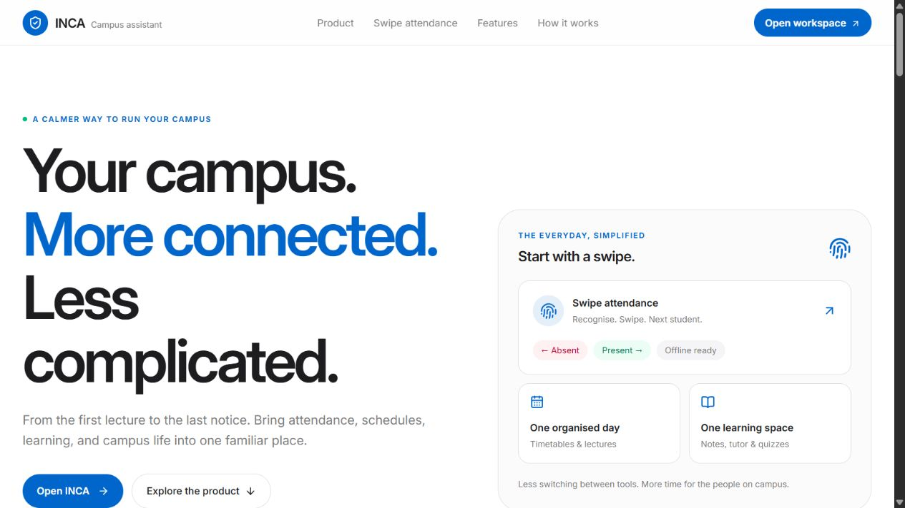

## Overview

INCA connects the everyday work of a college: organising classes, taking attendance, sharing learning resources, communicating announcements, and supporting the campus community. Students, faculty, coordinators, HODs, and administrators get role-aware workspaces backed by a shared academic foundation.

**ASSAM**, INCA's academic scheduling and attendance module, links timetables, lecture sessions, student rosters, attendance records, corrections, and reports. The wider platform adds AI-assisted learning, a marketplace, lost-and-found workflows, targeted notices, and community polls.

### Explore the deployed application

| Destination | Link |
| --- | --- |
| **Live application** | [inca-campus-portal.netlify.app](https://inca-campus-portal.netlify.app/) |
| **Sign in & demo accounts** | [Open the login page](https://inca-campus-portal.netlify.app/login) |
| **Interactive swipe demonstration** | [Try attendance with sample students](https://inca-campus-portal.netlify.app/#swipe-attendance) |
| **Backend API reference** | [Swagger / OpenAPI](https://inca-api.onrender.com/docs) |
| **Service health** | [API and database health](https://inca-api.onrender.com/health) |

The login page provides owner-approved public demo accounts for exploring different roles. The landing-page swipe practice uses fictional students and does not submit campus attendance. The demo backend uses Render's free tier, so an idle instance can take longer to respond on its first request.

## Major features

| Feature | What INCA provides |
| --- | --- |
| **Swipe attendance** | Recognise a student, swipe right for Present or left for Absent, or choose Late/Excused. Switch between cards and the roster, review the summary, and submit the lecture. |
| **Offline faculty workflow** | Prepare today's authorised classes and rosters while connected, save attendance drafts on the device, queue submissions, and confirm cloud upload when connectivity returns. |
| **Timetables & scheduling** | PDF timetable extraction, subject/faculty/room mapping, draft review, conflict checks, active timetable versions, dated schedules, and lecture exceptions. |
| **Student attendance workspace** | Own timetable, date-by-date lecture attendance, subject and date-range reports, all-time summaries, and lecture objections with a required reason. |
| **Academic administration** | Departments, programs, semesters, sections, subjects, rooms, faculty, and student accounts. Student registration includes actual enrollment details, contact information, class assignment, and photo upload. |
| **Profile approvals & account security** | Profile details and photos change through reviewer approval. Includes optional rejection remarks, rotating refresh sessions, first-login password changes, password recovery, and session revocation. |
| **AI Notes & Tutor** | Faculty-shared PDF/DOCX and linked learning resources, document-grounded tutor conversations, source citations, practice quizzes, and attempt history. |
| **Digital notice board** | Audience targeting, attachments, scheduled publication, faculty/HOD approval workflows, AI enrichment where configured, read tracking, acknowledgements, and notifications. |
| **Campus marketplace** | Listings and images, real-time conversations, offers, transactions, reviews, and reporting workflows. |
| **Lost & Found** | Lost/found reports, image-based matching assistance, ownership claims, and time-limited handover verification. |
| **Community polls** | Targeted campus polls, anonymous or identified ballots, participation, results, and voter reporting subject to access rules. |
| **Reports & activities** | Attendance insights across academic entities, personal student filters, campus events, and activity attendance. |

Green Credits is a planned module and remains marked **Coming Soon** in the application. External AI, storage, and recovery-email features depend on their configured providers.

## Product gallery

Screens below show the implemented interfaces with synthetic sample data. They are browser captures, not design mockups or live campus statistics. Select an image to view it at full resolution.

<table>
  <tr>
    <th width="33%">Swipe attendance</th>
    <th width="33%">AI Notes & Tutor</th>
    <th width="33%">Digital notices</th>
  </tr>
  <tr>
    <td align="center" valign="top"><a href="frontend/public/product-screens/attendance-mobile.jpg">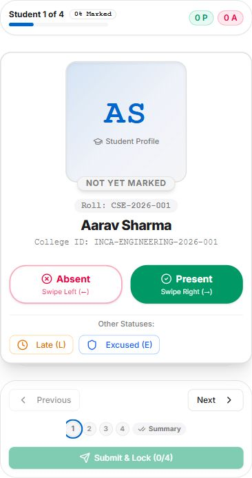</a></td>
    <td align="center" valign="top"><a href="frontend/public/product-screens/notes-mobile.jpg">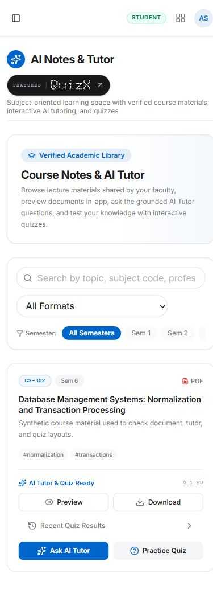</a></td>
    <td align="center" valign="top"><a href="frontend/public/product-screens/notices-mobile.jpg">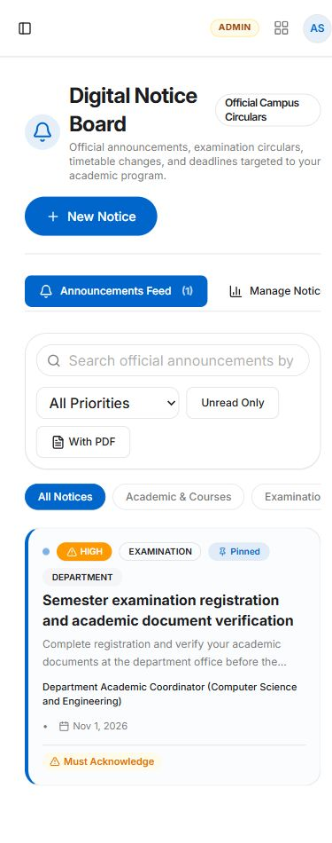</a></td>
  </tr>
  <tr>
    <th>Attendance reports</th>
    <th>Community polls</th>
    <th>Profile & security</th>
  </tr>
  <tr>
    <td align="center" valign="top"><a href="frontend/public/product-screens/reports-mobile.jpg">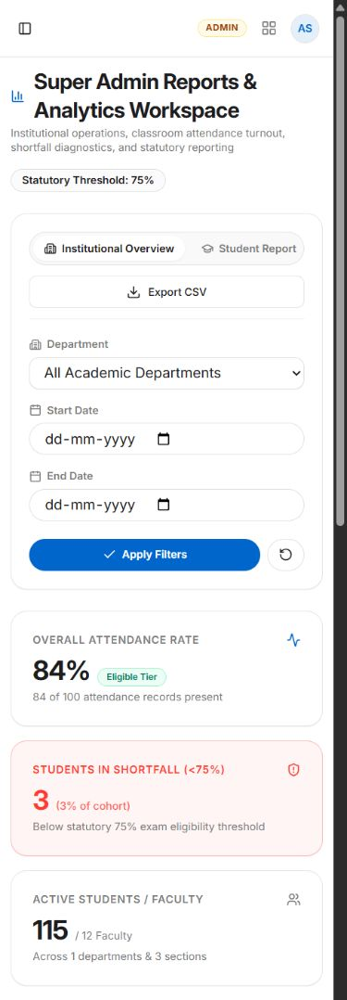</a></td>
    <td align="center" valign="top"><a href="frontend/public/product-screens/polls-mobile.jpg">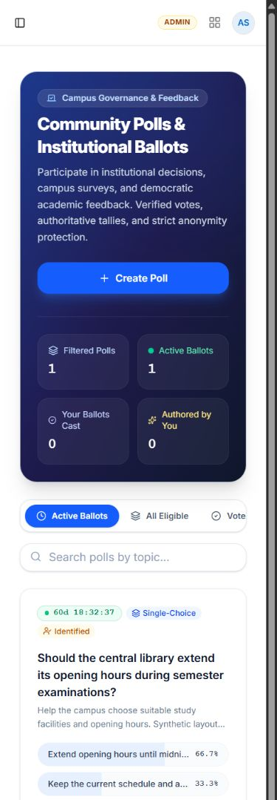</a></td>
    <td align="center" valign="top"><a href="frontend/public/product-screens/profile-mobile.jpg">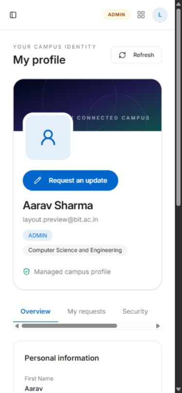</a></td>
  </tr>
</table>

<details>
<summary><strong>More screens: marketplace, lost & found, and student registration</strong></summary>
<br />
<table>
  <tr><th width="33%">Marketplace</th><th width="33%">Lost & Found</th><th width="33%">Student registration</th></tr>
  <tr>
    <td align="center" valign="top"><a href="frontend/public/product-screens/marketplace-mobile.jpg">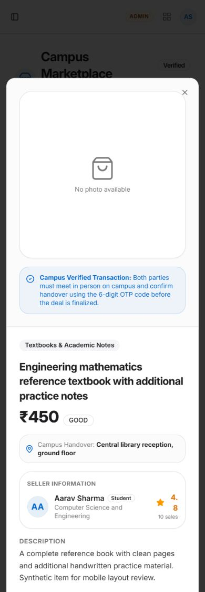</a></td>
    <td align="center" valign="top"><a href="frontend/public/product-screens/lost-found-mobile.jpg">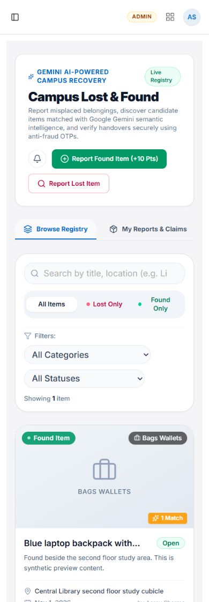</a></td>
    <td align="center" valign="top"><a href="docs/screenshots/student-registration-mobile.jpg">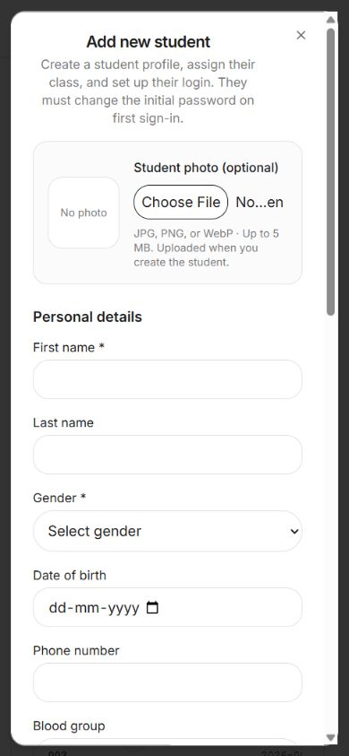</a></td>
  </tr>
</table>
</details>

Capture details and additional screens are listed in the [screenshot gallery](docs/screenshots/README.md) and [landing experience notes](docs/landing-page-revamp.md).

## Swipe attendance built for low connectivity

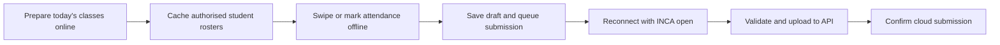

1. **Prepare:** Sign in online and prepare today's classes before entering a low-connectivity area.
2. **Mark:** Swipe cards or use the list; drafts persist in browser storage across reloads.
3. **Submit:** A queued local submission is shown as waiting for upload, separately from cloud confirmation.
4. **Synchronise:** INCA retries while the app is open and connected. Server validation checks the roster and detects conflicting changes before accepting records.
5. **Review:** Approved corrections and attendance-objection decisions retain an audit trail.

Use **Download / Install app** on the home page or hub to install the PWA in a supported browser. On iOS, follow the Safari Add to Home Screen instructions. Offline attendance requires prior preparation; it does not download unprepared classes or guarantee uploads while the app is closed. See the [offline attendance guide](docs/pwa-offline-attendance.md).

## Roles & workflows

| Role | Typical workspace |
| --- | --- |
| **Student** | Own timetable and attendance, lecture objections, profile update requests, course resources, notices, polls, and campus community services. |
| **Faculty** | Teaching timetable, prepared offline rosters, swipe/list attendance, course notes, activities, and relevant notices and reports. |
| **Coordinator** | Campus-wide attendance oversight and authorised operational workflows. |
| **HOD** | Department oversight, department-scoped profile and attendance-objection reviews, and student registration. |
| **Admin** | Academic administration, student registration across active departments, campus-wide eligible profile approvals, and attendance-objection review. |
| **Super Admin** | Institution administration, role/account management, administrator profile approvals, and read-only attendance oversight. |

Backend guards and services enforce permissions; a visible navigation link alone does not grant access. Profile self-approval is blocked. Faculty/HOD notices require approval; administrators can publish directly. Full details: [student workflows](docs/student-workflows.md) and [account lifecycle](docs/account-profile.md).

## Architecture

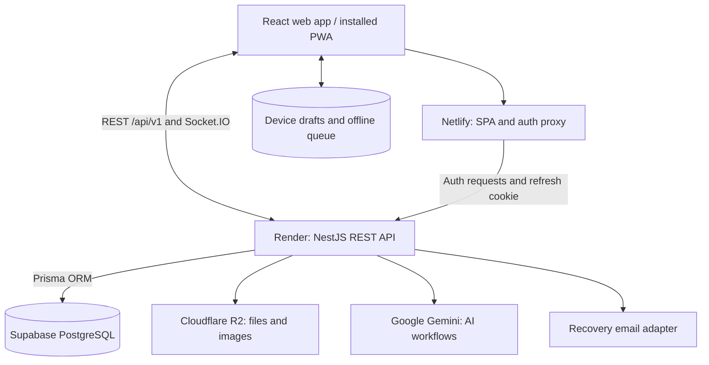

The current deployment uses **Netlify** for the frontend, **Render** for the backend, **Supabase PostgreSQL** for relational data, and **Cloudflare R2** for object storage. The codebase retains separate frontend/backend applications and provider configuration through environment variables.

### Technology stack

| Layer | Technologies |
| --- | --- |
| **Web application** | React 19, TypeScript, Vite 8, React Router |
| **UI & interaction** | Tailwind CSS 4, Radix UI, Lucide, GSAP, Framer Motion |
| **Data & forms** | TanStack Query/Table, Axios, React Hook Form, Zod, Recharts |
| **Backend** | NestJS 11, TypeScript, Passport/JWT, Socket.IO |
| **Database** | PostgreSQL, Prisma 6.19.3 |
| **Files & AI** | S3-compatible Cloudflare R2, Google Gemini, PDF/DOCX processing |
| **Offline support** | Service worker, installable web manifest, IndexedDB-backed attendance storage |
| **Delivery** | Netlify frontend, Render Node service, configurable recovery-email adapter |

Exact dependency versions are recorded in the separate [frontend](frontend/package-lock.json) and [backend](backend/package-lock.json) lockfiles.

## Getting started

### Prerequisites

- Node.js **24** for parity with the deployment, and npm.
- A dedicated PostgreSQL development database with runtime and direct connection URLs.
- R2 credentials for file uploads, a Gemini key for AI workflows, and an email adapter for recovery when those features are needed.

There is no root npm workspace: install and run the two applications separately.

### 1. Clone the repository

```sh
git clone https://github.com/exceptional007/INCA.git
cd INCA
```

### 2. Configure and start the backend

Create `backend/.env` from [backend/.env.example](backend/.env.example) if it does not already exist. Configure `DATABASE_URL`, `DIRECT_URL`, `JWT_SECRET`, and `FRONTEND_URL` at minimum.

```sh
cd backend
npm ci
npm run prisma:generate
npx --no-install prisma validate
```

**Prepare the database using the [backend setup guide](backend/README.md#database-preparation) before starting the server.** Some current modules predate complete migration coverage, so the checked-in migrations alone are not a guaranteed fresh-database bootstrap. Use the documented isolated-development bootstrap or a reviewed baseline appropriate to your database.

```sh
npm run start:dev
```

Optional role/bootstrap seeding is documented in the backend guide. Review the seed first: its fixed development credential is not a production account-provisioning mechanism.

### 3. Configure and start the frontend

In a second terminal, create `frontend/.env` from [frontend/.env.example](frontend/.env.example) if it does not already exist.

```dotenv
VITE_API_URL=http://localhost:3000/api/v1
```

```sh
cd frontend
npm ci
npm run dev
```

| Local service | Default URL |
| --- | --- |
| Frontend | [localhost:5173](http://localhost:5173/) |
| API | [localhost:3000/api/v1](http://localhost:3000/api/v1) |
| API docs | [localhost:3000/docs](http://localhost:3000/docs) |
| Health | [localhost:3000/health](http://localhost:3000/health) |

### Environment configuration

| Location | Variables | Purpose |
| --- | --- | --- |
| Backend | `DATABASE_URL`, `DIRECT_URL` | PostgreSQL runtime and Prisma migration connections. |
| Backend | `JWT_SECRET`, `FRONTEND_URL`, `PORT`, `NODE_ENV` | Authentication, allowed frontend origin, and server runtime. |
| Backend | `R2_ACCOUNT_ID`, `R2_BUCKET_NAME`, `R2_ACCESS_KEY`, `R2_SECRET_KEY` | Object storage for photos, documents, and attachments. |
| Backend | `GEMINI_API_KEY`, `GEMINI_MODEL` | External AI generation and extraction. |
| Backend | `PASSWORD_MAIL_PROVIDER`, `PASSWORD_MAIL_API_URL`, `PASSWORD_MAIL_API_KEY` | Recovery-email delivery; supports the configured Google Apps Script gateway. |
| Backend | `AUTH_COOKIE_SAME_SITE`, `TRUST_PROXY_HOPS` | Deployment-specific cookie and proxy settings. |
| Frontend | `VITE_API_URL`, `VITE_AUTH_API_URL` | Public API base and optional same-origin auth proxy. |

Keep secrets in private backend configuration. `VITE_*` values are embedded in the browser bundle and must contain public configuration only. See the [backend configuration reference](backend/README.md#environment-configuration) for optional diagnostics and connection settings.

## Development & validation

| Directory | Command | Purpose |
| --- | --- | --- |
| `backend/` | `npm run start:dev` | API development server. |
| `backend/` | `npm run build` | Compile the NestJS application. |
| `backend/` | `npm test -- --runInBand` | Run backend regression tests. |
| `backend/` | `npm run db:migrate:deploy` | Apply reviewed migrations to a correctly baselined target database. |
| `frontend/` | `npm run dev` | Vite development server. |
| `frontend/` | `npm run build` | Typecheck and build the production SPA/PWA. |
| `frontend/` | `npm run build:netlify` | Production build plus Netlify auth-proxy and SPA routing configuration. |
| `frontend/` | `npm run lint` | Oxlint analysis. |

Focused tests cover account/profile lifecycle, registration and photo handling, authorisation, attendance corrections and objections, notice workflows, and offline sync. Local browser fixtures use synthetic data for responsive and interactive checks. Physical-device and external-provider acceptance checks remain separate from mocked integration tests.

## Repository structure

```text
INCA/
├── backend/
│   ├── prisma/                 # Schema, migrations, and bootstrap seed
│   ├── src/common/             # Guards, filters, middleware, decorators
│   ├── src/modules/            # Academic, attendance, identity, AI, community APIs
│   ├── src/prisma/             # Database lifecycle and diagnostics
│   └── test/                   # Integration support and e2e configuration
├── frontend/
│   ├── public/                 # Icons, web manifest, and product screenshots
│   ├── scripts/                # Build tools and isolated UI fixtures
│   └── src/
│       ├── components/         # Shared UI, layouts, landing, and attendance
│       ├── context/            # Authentication state
│       ├── offline/            # Attendance preparation, drafts, and sync queue
│       ├── pages/              # Role-aware screens and workflows
│       ├── services/           # API clients and realtime integration
│       └── types/              # Client data contracts
├── docs/                       # Setup, deployment, workflows, and screenshots
├── ops/google-apps-script/     # Gmail recovery-email gateway
├── render.yaml                 # Backend deployment blueprint
└── LICENSE
```

## Deployment

- **Frontend:** Netlify builds `frontend/` with `npm run build:netlify` and publishes `frontend/dist/` with SPA fallback and the generated auth proxy.
- **Backend:** Render builds `backend/`, generates the Prisma client, compiles NestJS, and runs `npm run start:prod`.
- **Health monitoring:** `/health` checks the service and database connection.
- **Database upgrades:** Apply reviewed migrations separately; keep both schema state and migration history aligned with the target database.
- **Integrations:** Configure private database, JWT, R2, Gemini, frontend-origin, and recovery-email settings on the backend host.

Follow the [Render + Netlify deployment guide](docs/deploy-render-netlify.md) for the complete setup and [Gmail recovery guide](docs/gmail-recovery-setup.md) for the current email adapter. Scheduled notices are checked at startup and at 30-second intervals while the backend is running.

## Documentation

| Guide | Contents |
| --- | --- |
| [Frontend](frontend/README.md) | Local setup, routes, UI structure, API configuration, and build commands. |
| [Backend](backend/README.md) | Database preparation, modules, API entry points, and environment reference. |
| [Student workflows](docs/student-workflows.md) | Registration, department selection, profile approvals, personal attendance, and objections. |
| [Accounts & profiles](docs/account-profile.md) | Password lifecycle, refresh sessions, recovery, and profile-change requests. |
| [PWA & offline attendance](docs/pwa-offline-attendance.md) | Preparation, persistence, queue states, sync protocol, and testing. |
| [Late attendance approvals](docs/late-attendance-approvals.md) | Faculty grace period, Admin/HOD review, expiry, auditing, and offline retry behaviour. |
| [Deployment](docs/deploy-render-netlify.md) | Netlify, Render, proxy, secrets, and health configuration. |
| [Recovery email](docs/gmail-recovery-setup.md) | Google Apps Script gateway setup and recovery-link configuration. |
| [Local demo](docs/demo.md) | Walkthrough and development data prerequisites. |
| [Screenshots](docs/screenshots/README.md) | Capture provenance and additional interface images. |
| [Mobile UI audit](docs/mobile-ui-audit.md) | Responsive-screen verification. |
| [Interaction audit](docs/interaction-ui-audit.md) | Modals, swipe attendance, and interactive behaviour. |
| [Landing experience](docs/landing-page-revamp.md) | Product tour, sample-data previews, animations, and accessibility. |

## Contributing

Create a focused branch, keep the existing module boundaries, and describe the behaviour your change affects. Use a development database and synthetic data for verification. Run the relevant backend checks and the frontend build/lint for affected workflows; include screenshots for UI changes. Never commit environment secrets or private campus records.

Report reproducible problems through [GitHub Issues](https://github.com/exceptional007/INCA/issues), including the role, affected route, steps, and expected behaviour.

## License

[MIT License](LICENSE) · Copyright © 2026 Akshhat Srivastava.

The backend package currently retains `UNLICENSED` in its package metadata; consult the repository license and reconcile that metadata before redistribution.

---

<p align="center"><strong>INCA · Intelligent Campus Assistant</strong><br />A connected campus, from the first lecture to the last notice.</p>
