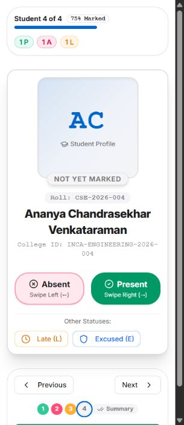
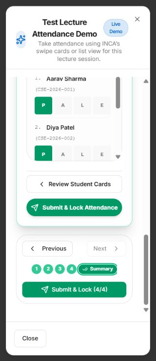

# INCA interaction and responsive UI audit

Reviewed on 1 November 2026. This extends [the mobile layout review](mobile-ui-audit.md) with actual interactions in the existing React components and application routes.

## Method and scope

Tests used a localhost Vite preview with synthetic users, rosters, PDFs, messages, and in-memory API responses. The preview does not load `.env` or contact the production backend, database, email, or storage. These tests verify frontend behavior against inspected API response shapes; they do not establish production end-to-end business authorization or service availability.

Phone interactions used 320px and 390px viewports. The final regression checked attendance cards, lecture attendance, poll creation, notice creation, chat, and lost-item reporting at **320 × 640, 768 × 1024, and 1440 × 900**. Those checks found no document-wide horizontal overflow or overflowing dialog content. Longer dialogs scroll within the viewport. The earlier review covers the other primary pages and all six role dashboards.

## Changes made

- Attendance swipe cards retain vertical page scrolling while accepting horizontal drags. Buttons and roster summaries fit narrow screens and expose selected states and descriptive labels. Status changes are blocked during submission and after locking; shortcuts ignore text editing, modifier keys, and unrelated open dialogs.
- Submitted-attendance corrections now use the actual saved record ID, initialize the existing status, require a meaningful reason, update visible counts after success, and show recoverable errors inside the dialog. Previously, the action constructed a nonexistent record ID.
- Nine lost-and-found and poll dialogs now use the existing shared Radix dialog component for Escape, focus trapping, and modal semantics. Shared dialogs restore focus to their opener and reserve header space for the close control.
- Lost-item reporting respects the requested Lost/Found type on reopening. Photo previews release object URLs and allow reselecting a removed file. Photo removal controls are labelled.
- Poll options are keyboard-operable buttons with selected states. Dynamic option removal, quiz choices, rating stars, chat send controls, note menus, and publication switches have accessible names or states.
- Notice publication and expiry fields stack on phones. Missing/past scheduled publication and expiry preceding publication are rejected before submitting.
- Faculty and institutional reports render in separate components so switching between them cannot change the order of React hooks. This also resolves the reports page's lint errors.

## Interactions exercised

| Feature | Checks performed |
| --- | --- |
| Attendance swipe | Real pointer drags left/right; present, absent, late and excused buttons; previous/next; long student name; summary adjustments; submit and locked disabled controls |
| Attendance session | Open lecture, list/card switching, bulk marking, submit/lock, actual-record correction, inline simulated failure, retained input, successful retry, updated status and focus return |
| Lecture attendance demo | Card/list views share status counts; individual list changes appear in card summary; narrow nested-dialog layout and header close spacing |
| Dialogs | 22 detail/action dialogs opened and dismissed with Escape; opener focus checked in lost-item reporting; focus remained inside poll creation when tabbing backward; short-screen scrolling |
| Notes | Upload source switching, tags add/remove, publish/draft switch; edit/replacement/delete confirmation layouts; PDF preview and an actual synthetic PDF download |
| AI quiz | Generate, answer, next, submit, score/explanation/citations, recent-results menu, reopen saved result |
| AI tutor | Ask, rendered answer, expand source citation, new conversation, restore saved chat |
| Marketplace | Send chat message, create/cancel structured offer, choose star rating, submit synthetic review; listing/report/create/detail dialog layout coverage |
| Lost and found | Reopen with correct report type, upload two synthetic photos, remove a photo, verify remaining preview, claim pending feedback, handover completion feedback, matches/detail dialog coverage |
| Polls | Keyboard-select voting option, submit vote, results and voter-report dialogs; add/remove creation options, multiple-choice setting, delayed result visibility and reveal-date field |
| Notices | Expand schedule/expiry, date validation, mobile date readability, live preview; detail/analytics/review dialogs |
| Profile | Request phone update, pending status, review changed values, approval updates displayed profile, rejection requires feedback, revoke another synthetic session |
| Academic master | Department validation; all six entity create dialogs and populated edit dialogs opened/cancelled; long forms remain usable on phones |
| Reports | Institutional overview, student drilldown, faculty workspace; student/section/subject/faculty report layout galleries |
| Timetable/import | Lecture/upload/review/history dialog layout and keyboard dismissal; scheduling page layout covered in prior review |

## Validation and limits

The production TypeScript/Vite build and Netlify redirect generation pass with the Render API URL configured. Frontend lint passes with existing warnings (effect dependencies, render-time component declarations, compiler advisories, and unused variables). No dependency or database changes were made.

This is not a claim that every possible feature state was tested. Real iOS/Android touch and keyboard behavior, camera selection, production uploads, live AI responses, email delivery, concurrent users, and complete buyer/seller handover or timetable import transactions remain separate end-to-end checks. Destructive live actions and real attendance/profile/publication changes were not used for this audit.

## Reproduce locally

From `frontend`, run `node scripts/mobile-preview-server.mjs`. Open `http://127.0.0.1:5187/__fixture?role=ADMIN&page=/hub`. Other supported roles are STUDENT, FACULTY, HOD, COORDINATOR and SUPER_ADMIN. Visiting `/__fixture` resets synthetic interaction state.

Component previews use `/__components?case=attendance-swipe` or `/__components?case=create-poll&interactive=1`. The latter starts closed so the Reopen preview button can be used to test opening, closing, and focus behavior. The case catalog is in `scripts/mobile-component-gallery.tsx`. In-memory responses are in `scripts/interaction-fixtures.mjs`; synthetic PDF generation is in `scripts/preview-document.mjs`. These scripts are not imported into the production application.

To exercise a one-shot error, add `&failNext=/attendance/records/demo-record-1/edit` to the fixture URL, then submit the session and correct the first student. The first save fails locally and the retry succeeds. `/api/v1/__test/state` exposes synthetic request paths and state for diagnosis only on the local preview.

