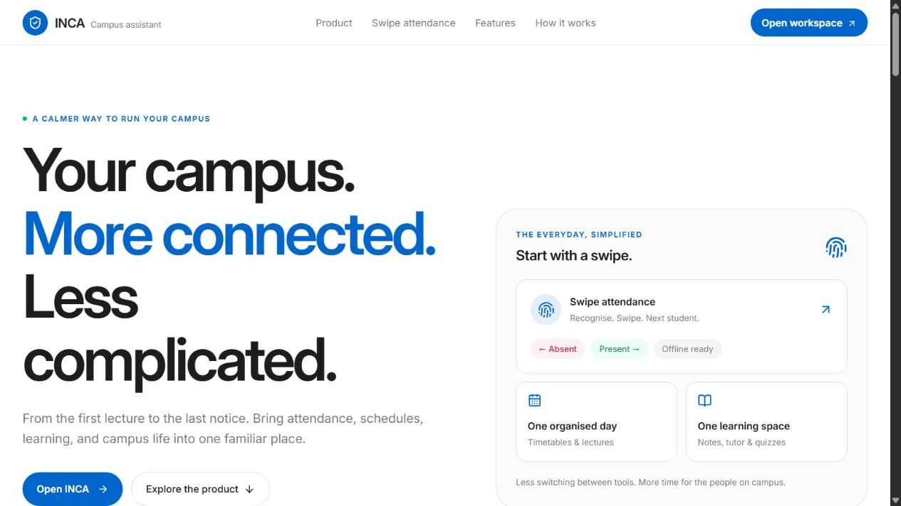
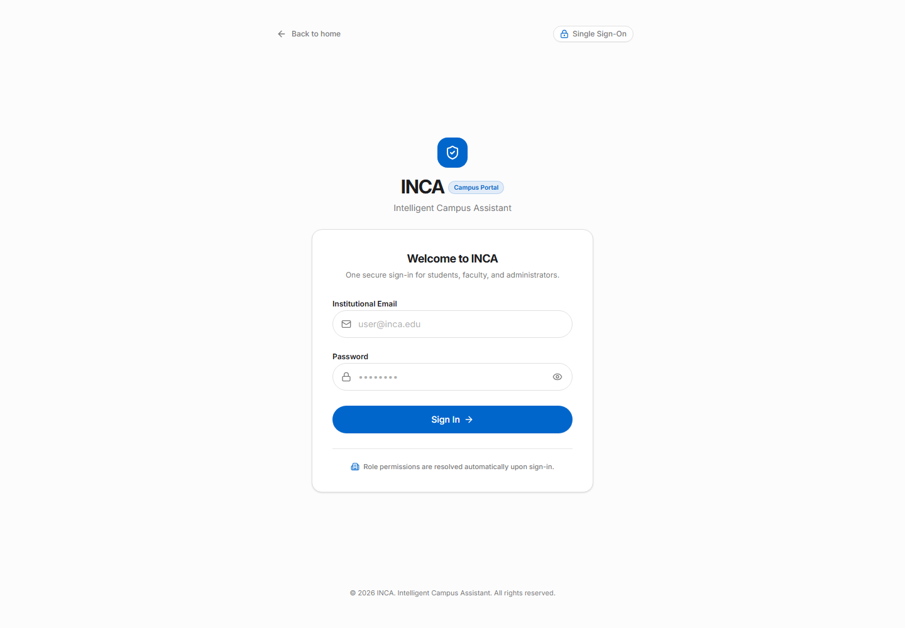

# INCA screenshot gallery

These images are browser captures of implemented INCA interfaces. Authenticated product previews use synthetic data. The current landing capture comes from the public deployed application; earlier captures remain available as historical references. No generated mockups are presented as application screenshots.

| Image | Route | Account / dataset |
| --- | --- | --- |
| [Current landing page](landing-desktop-current.jpg) | `/` | Public deployed frontend; 1280 × 720 viewport; 2 November 2026; no private campus records |
| [Landing page](landing-page.png) | `/` | Public; no account or backend connection |
| [Sign-in page](login.png) | `/login` | Public; fields empty, no credentials entered |
| [Profile desktop](profile-demo.png) | `/profile` | Synthetic STUDENT, disposable local PostgreSQL; 1440 × 1100; 1 November 2026 |
| [Profile mobile](profile-mobile-demo.png) | `/profile` | Same synthetic STUDENT; 390 × 844; 1 November 2026 |
| [Student registration](student-registration-mobile.jpg) | `/academic` | Local synthetic Admin workflow; 390 × 844; 1 November 2026 |
| [Mobile landing](landing-revamp-mobile.jpg) | `/` | Updated public landing; 1 November 2026 |
| [Offline upload queue](pwa-attendance-pending.png) | `/attendance/mark` | Synthetic faculty roster and queued submission |

## Capture checklist

1. Run the current frontend against an isolated development backend/database if authenticated pages are needed. Public pages require only the frontend.
2. Use synthetic campus data and a dedicated demo account with the role needed for the screen.
3. Use a consistent viewport and wait for fonts, loading states, and entrance animations to finish.
4. Capture the actual page, not a design mockup. Do not show secrets, OTPs, access tokens, credentials, or identifiable campus records.
5. Save a descriptive PNG filename in this directory. Inspect it at readable size before adding a Markdown reference.
6. Record route, role, dataset, viewport, and capture date in this table. Confirm every referenced file exists.

## Product preview gallery

The root README also uses the following captures from [frontend/public/product-screens](../../frontend/public/product-screens/). They were captured from the actual React components with local synthetic fixtures on 1 November 2026 and are also used in the public landing-page product tour.

| Interface | Image | Capture dimensions |
| --- | --- | --- |
| Swipe attendance | [Attendance](../../frontend/public/product-screens/attendance-mobile.jpg) | 366 × 694 |
| Timetable | [Scheduling](../../frontend/public/product-screens/scheduling-mobile.jpg) | 366 × 154 |
| Notice board | [Notices](../../frontend/public/product-screens/notices-mobile.jpg) | 375 × 950 |
| Notes and tutor | [Notes](../../frontend/public/product-screens/notes-mobile.jpg) | 375 × 1043 |
| Marketplace | [Marketplace](../../frontend/public/product-screens/marketplace-mobile.jpg) | 390 × 1121 |
| Lost and found | [Lost & Found](../../frontend/public/product-screens/lost-found-mobile.jpg) | 390 × 1121 |
| Attendance reports | [Reports](../../frontend/public/product-screens/reports-mobile.jpg) | 375 × 1078 |
| Community polls | [Polls](../../frontend/public/product-screens/polls-mobile.jpg) | 375 × 1078 |
| Academic administration | [Academic](../../frontend/public/product-screens/academic-mobile.jpg) | 328 × 943 |
| Profile | [Profile](../../frontend/public/product-screens/profile-mobile.jpg) | 375 × 811 |

These illustrate sample UI states; they do not claim current campus totals or successful external-provider operations. See [landing experience verification](../landing-page-revamp.md) for the capture and responsive-review workflow.
